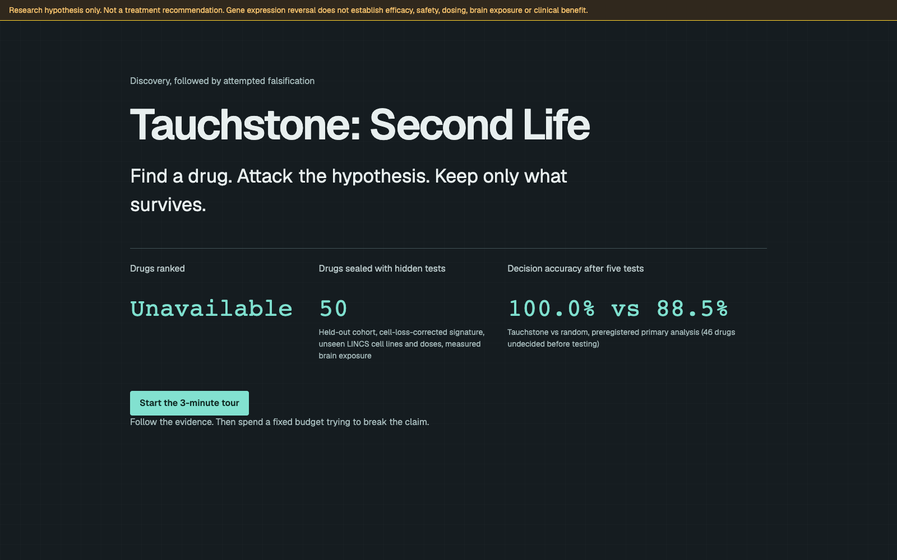
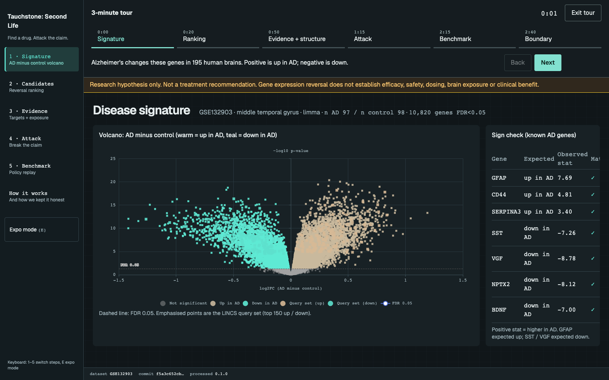
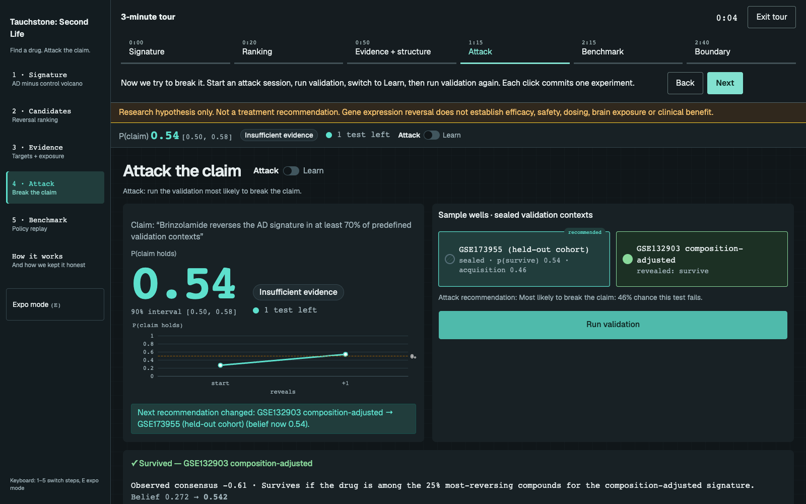
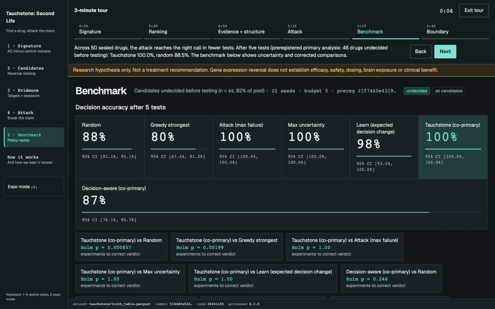
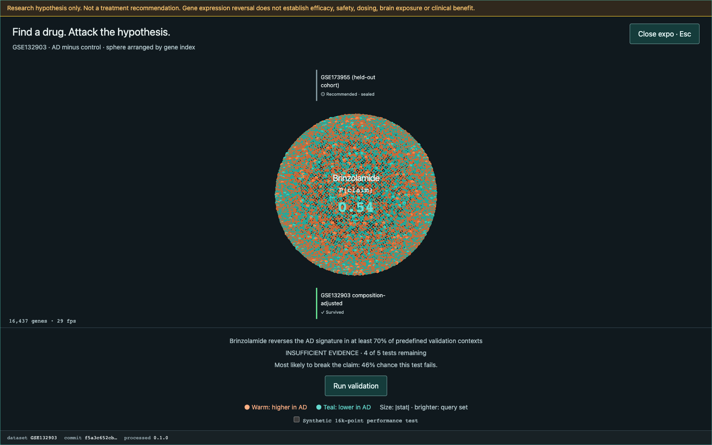
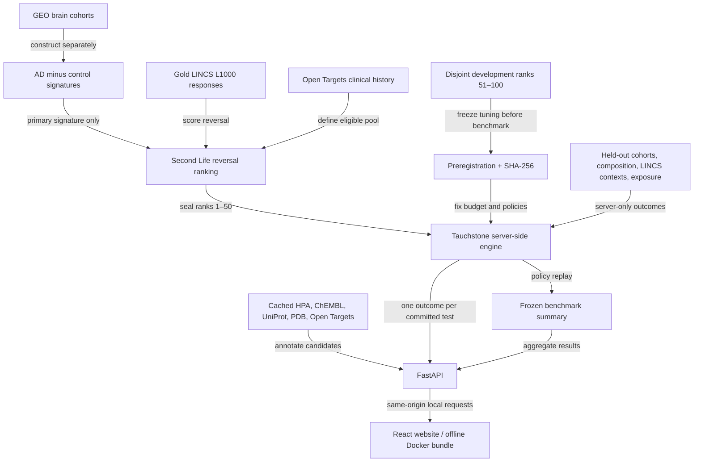

# Tauchstone: Second Life

Find a drug. Attack the hypothesis. Keep only what survives.

Second Life builds an Alzheimer's brain expression signature from 195 human brains, GSE132903.

It ranks 1,816 clinical-stage drugs by reversal of that signature in gold LINCS L1000 responses.

Each candidate has a cached evidence card with targets, brain expression, associations and structures.

Tauchstone chooses held-out tests that could break the claim, revealing one committed outcome at a time.

The website is the pitch: start on Landing, take the story tour, run an attack, then inspect Benchmark.

> Research hypothesis only. Not a treatment recommendation. Gene expression reversal does not establish efficacy, safety, dosing, brain exposure or clinical benefit.

## The result, and its limits

The preregistered primary analysis is the **46 drugs undecided before testing, of 50 sealed candidates**, across 20 seeds with a budget of 5 tests. Decision accuracy after 5 tests was **Tauchstone 100% vs random 88.5%**. Tauchstone needed fewer experiments to a correct verdict than random, Holm p = **0.0009**. That p-value concerns experiments to a correct verdict, not accuracy. Tauchstone tied max_failure and max_uncertainty.

Read the [integrity log](docs/integrity_log.md) before interpreting the result. It records method changes, the development pool, code fixes after freeze and the final exposure-data correction. Its historical headline rounds random accuracy to 0.88. The website reads current figures from `/benchmark`.

The [frozen preregistration](data/manifests/preregistration.yaml), committed at `8ed0885`, has SHA-256:

```text
21f7460e4319a7e30a24af50d7b3cfa2da84adbd0313b44250ed6bd1834bb8a3
```

```sh
shasum -a 256 data/manifests/preregistration.yaml
```

The permutation gate was **not met**. In the gold clinical pool, 17/20 compounds had compound-level p_perm < 0.05; the gate required all 20. The separate selection-aware rank-matched check was 15/20. The top 5 did not go beyond the shuffled-label null. The decision-aware co-primary did not beat random on the sealed pool, Holm p = 0.25. These limitations remain part of the pitch. See the [algorithm record](contracts/algorithms.md) and [QA report](docs/qa_report.md) for definitions and unresolved checks.

## Walk through the website

Screenshots from the restyled app on real data (GSE132903, 1,816 ranked drugs), captured on the build Mac at 1600×1000.

| Landing | Story tour |
|---|---|
|  |  |
| **Attack** | **Benchmark** |
|  |  |
| **Expo mode** | |
|  | |

The [About panel](apps/web/src/features/about/) (nav item "How it works") explains the pipeline and integrity record.

## Run offline

The [offline runbook](docs/offline.md) describes building, transferring and rehearsing the frozen bundle. With Docker images already loaded and `data/demo/processed` plus `data/demo/MANIFEST.json` copied from the build machine:

```sh
make up
curl -fsS http://localhost:8080/api/health
# Open http://localhost:8080. Health must report mock:false.
make down
```

On the machine holding the processed research outputs, `make demo` builds the bundle and Docker images. First-time image builds need network. The transferred images and bundle run with Wi-Fi off; no data download or live evidence lookup happens during the demo. The server retains the truth table and releases only one outcome per committed experiment.

## Reproduce from scratch

Needs Python 3.12 via uv, Bun, Homebrew R and Docker. Install R prerequisites with `brew install r libxml2 pkgconf`. Data lives outside git in `$TS_DATA_DIR`, default `~/Data/tauchstone`. Read [AGENTS.md](AGENTS.md) before changing a pipeline.

Run these steps in order on a research machine, not during the expo. Downloads require tens of GB, about 33 GB compressed plus about 29 GB for unpacked LINCS matrices. Setup and download time depend on network and cache; allow hours for a fresh build. The Makefile estimates about 15 minutes for permutation scoring with 12 workers. Other pipeline timings have not been measured on this Mac.

```sh
make setup
make data
make unpack-lincs
make signatures
make rank
make permutation-control
make evidence
make truth-table
make benchmark
make test test-r
```

`make data` downloads and records checksums. For an audit, compare against the committed [checksum manifest](data/manifests/checksums.json); do not commit a refreshed manifest as though it were the frozen record. Each processed artifact carries provenance and random seeds where relevant. Reproduction must preserve the preregistration, disjoint pools and held-out boundaries. Do not overwrite the frozen benchmark bundle with a new run.

For a presentation-only local preview with synthetic data:

```sh
uv sync
cd apps/web
bun install
VITE_USE_MOCK=1 bun run dev -- --port 5177
```

Open `http://localhost:5177`. Mock ribbons identify synthetic results; they do not reproduce the research findings.

## Architecture



Entrez Gene ID, stored as a string, joins gene records. HGNC symbols and Ensembl IDs are annotations. Positive signature values mean up in AD; negative drug scores indicate reversal. Each cohort keeps its own signature. Missing covariates remain `unspecified`.

## Data sources and reuse terms

Sources and pinned files are listed in [sources.toml](data/manifests/sources.toml). The links below point to upstream reuse terms; preserve source identifiers and cite the contributing datasets when reusing outputs.

| Source | Role | Licence / terms |
|---|---|---|
| GEO, GSE132903, GSE173955, GSE53697 | Primary and held-out brain cohorts | Publicly accessible deposits; consult dataset publications and [NCBI policies](https://www.ncbi.nlm.nih.gov/home/about/policies/) for reuse. Public access is not a blanket licence for every submission. |
| LINCS, GSE92742 and GSE70138 | L1000 perturbation responses | Public GEO releases; preserve accession/publication attribution and consult [Broad data terms](https://clue.io/data/terms). No blanket CC licence is asserted here. |
| Open Targets 26.09 | Clinical-stage pool, targets and AD associations | [CC0 1.0; source licensing details](https://platform-docs.opentargets.org/licence) |
| Human Protein Atlas | Brain expression context | [CC BY 4.0; third-party exceptions apply](https://www.proteinatlas.org/about/licence) |
| ChEMBL 37 | Mechanisms, targets, exposure assays | [CC BY-SA 3.0](https://www.ebi.ac.uk/chembl/) |
| UniProt reviewed human proteome | Protein and identifier mapping | [CC BY 4.0](https://www.uniprot.org/help/license) |
| wwPDB / SIFTS | Target structures and protein mapping | [PDB archive CC0 1.0](https://www2.rcsb.org/pages/usage-policy); [SIFTS attribution and access](https://www.ebi.ac.uk/pdbe/docs/sifts/) |

## Scientific boundary

A candidate is an expression-reversal hypothesis. Bulk brain composition, LINCS cell contexts and incomplete exposure evidence limit interpretation. Brain exposure is always labelled measured, curated or predicted; absent measured exposure is untestable rather than a failed test. A PDB structure supplies target context, never binding evidence.

Verdicts are SUPPORTED SO FAR, FRAGILE / CONTEXT-DEPENDENT or INSUFFICIENT EVIDENCE. Human review is required for every signature, threshold and claim wording. Held-out information must never feed signature construction, ranking, thresholds, tuning or demo-candidate selection. The browser never receives the truth table.
