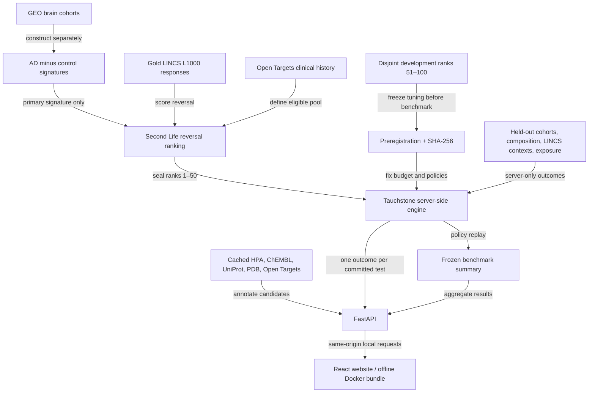
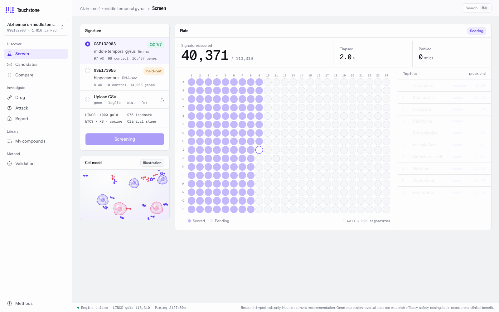
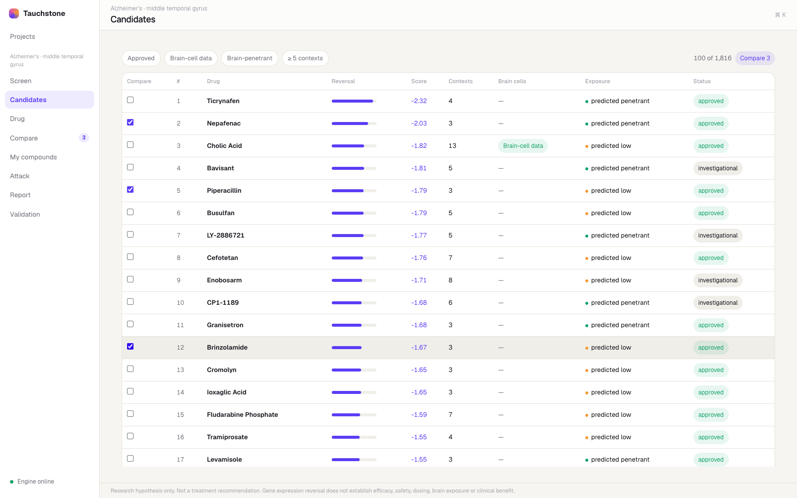
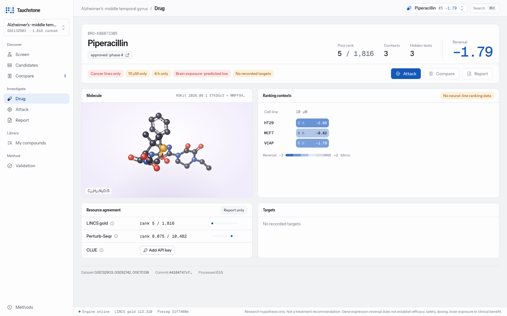
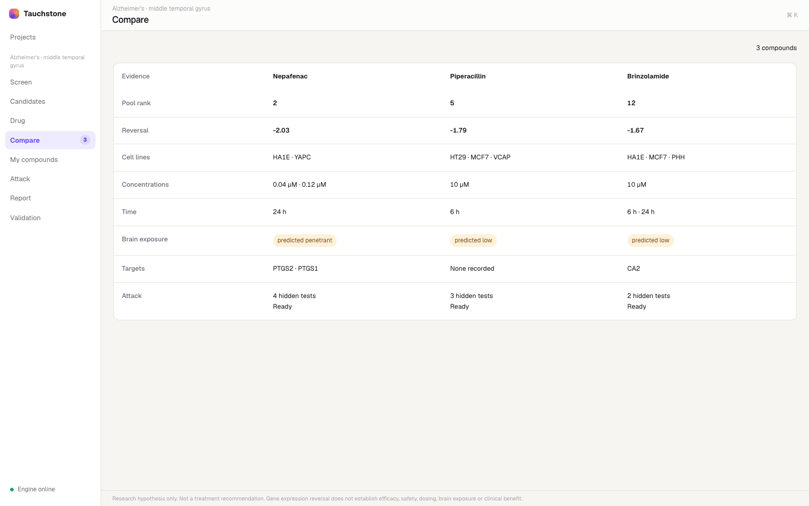
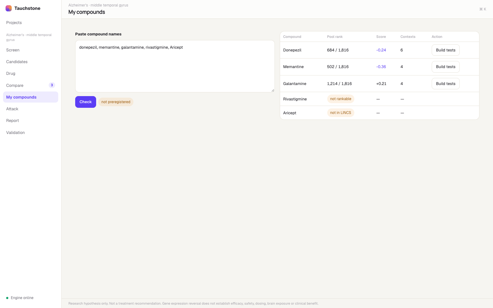
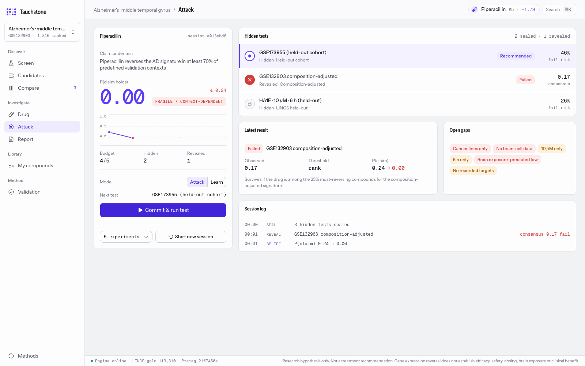
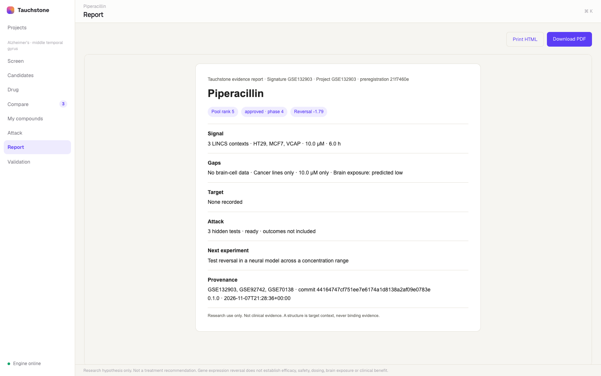
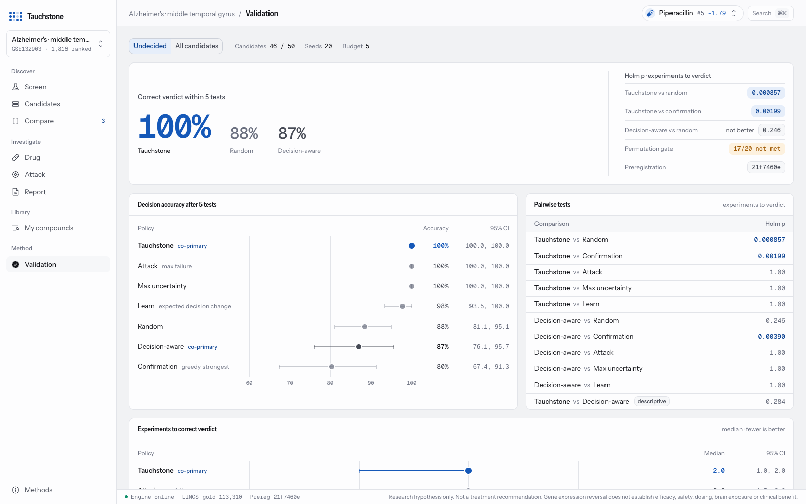

# Tauchstone: Second Life

Tauchstone: Second Life looks for existing drugs whose gene expression response runs opposite to the changes in the Alzheimer's brain, then tries to prove each one wrong. Second Life builds an Alzheimer's expression signature from 195 human brains (GSE132903) and ranks 1,816 clinical-stage drugs by how strongly their gold LINCS L1000 responses reverse it. Tauchstone then picks held-out tests that could break each claim and reveals one committed outcome at a time, so a candidate only survives on evidence it was never tuned on.

> Research hypothesis only. Not a treatment recommendation. Gene expression reversal does not establish efficacy, safety, dosing, brain exposure or clinical benefit.

The website is a working research tool. You can screen a signature live, filter and compare candidates, see each drug's evidence gaps, check a lab's own compounds, attack a candidate and export a report.

## Run it offline

The [offline runbook](docs/offline.md) covers building, transferring and rehearsing the frozen bundle. Once the Docker images are loaded and the whole `data/demo` directory (about 1.1 GB, including the LINCS gold arrays for live screens) is copied from the build machine, run:

```sh
make up
curl -fsS http://localhost:8080/api/health
# Open http://localhost:8080. Health must report mock:false.
make down
```

On the machine that holds the processed research outputs, `make demo` builds the bundle and the Docker images. First-time image builds need network. After that, the images and bundle run with Wi-Fi off, and the demo downloads no data and looks up no evidence live. The server keeps the truth table and releases one outcome per committed experiment.

## Preview with synthetic data

For a presentation-only local preview:

```sh
uv sync
cd apps/web
bun install
VITE_USE_MOCK=1 bun run dev -- --port 5177
```

Open `http://localhost:5177`. Mock ribbons mark synthetic results. They don't reproduce the research findings.

## Reproduce from scratch

You need Python 3.12 via uv, Bun, Homebrew R and Docker. Install the R prerequisites with `brew install r libxml2 pkgconf`. Data lives outside git in `$TS_DATA_DIR`, default `~/Data/tauchstone`. Read [AGENTS.md](AGENTS.md) before changing a pipeline.

Run these steps in order on a research machine, never during the expo. The downloads take tens of GB, about 33 GB compressed plus about 29 GB for the unpacked LINCS matrices. Setup and download time depend on your network and cache, so allow hours for a fresh build. The Makefile estimates about 15 minutes for permutation scoring with 12 workers. We haven't timed the other pipelines on this Mac.

```sh
make setup
make data
make unpack-lincs
make signatures
make rank
make permutation-control
make evidence
make truth-table
make benchmark
make test test-r
```

`make data` downloads the sources and records checksums. For an audit, compare them against the committed [checksum manifest](data/manifests/checksums.json). A refreshed manifest is not the frozen record, so don't commit it as one. Each processed artifact carries provenance, plus random seeds where they apply. A reproduction must keep the preregistration, the disjoint pools and the held-out boundaries intact. Don't overwrite the frozen benchmark bundle with a new run.

## How it works



Each cohort keeps its own signature. Positive signature values mean up in AD, and a negative drug score means reversal. Gene records join on Entrez Gene ID, stored as a string; HGNC symbols and Ensembl IDs are annotations. Missing covariates stay `unspecified`.

Each candidate has a cached evidence card with targets, brain expression, associations and structures.

### The website

These screenshots show real data (GSE132903, 1,816 ranked drugs) at 1600×1000. The expo order is in [docs/expo_day_checklist.md](docs/expo_day_checklist.md).

| Live screen (113,310 gold LINCS signatures) | Candidates |
|---|---|
|  |  |
| **Drug: gaps, 3D molecule, resource agreement** | **Compare** |
|  |  |
| **My compounds** | **Attack after one committed test** |
|  |  |
| **Report (PDF export)** | **Validation (frozen benchmark)** |
|  |  |

Uploads, ad-hoc tests and resource agreement are labelled *not preregistered*. The [integrity log](docs/integrity_log.md) records each one.

## What it claims, and what it doesn't

### The result

The preregistered primary analysis covers the **46 drugs undecided before testing, of 50 sealed candidates**, across 20 seeds with a budget of 5 tests. After 5 tests, decision accuracy was **Tauchstone 100% vs random 88.5%**. Tauchstone also needed fewer experiments than random to reach a correct verdict, Holm p = **0.0009**. That p-value is about experiments to a correct verdict, not accuracy. Tauchstone tied max_failure and max_uncertainty.

Read the [integrity log](docs/integrity_log.md) before you interpret the result. It records the method changes, the development pool, the code fixes after the freeze and the final exposure-data correction. Its historical headline rounds random accuracy to 0.88. The website reads current figures from `/benchmark`.

The [frozen preregistration](data/manifests/preregistration.yaml) was committed at `e11071c` (earlier ID `8ed0885`). Its SHA-256 is:

```text
21f7460e4319a7e30a24af50d7b3cfa2da84adbd0313b44250ed6bd1834bb8a3
```

```sh
shasum -a 256 data/manifests/preregistration.yaml
```

### The limits

The permutation gate was **not met**. In the gold clinical pool, 17/20 compounds had compound-level p_perm < 0.05, and the gate required all 20. The separate selection-aware rank-matched check came out at 15/20. The top 5 did not go beyond the shuffled-label null. The decision-aware co-primary did not beat random on the sealed pool, Holm p = 0.25. We present these limits alongside the result. The [algorithm record](contracts/algorithms.md) and the [QA report](docs/qa_report.md) give the definitions and list the checks still open.

### The scientific boundary

A candidate is an expression-reversal hypothesis and nothing more. Bulk brain composition, LINCS cell contexts and incomplete exposure evidence all limit how far it can be read. Brain exposure is always labelled measured, curated or predicted. A drug with no measured exposure is untestable on that point, which is different from failing the test. A PDB structure gives target context, never binding evidence.

Verdicts are SUPPORTED SO FAR, FRAGILE / CONTEXT-DEPENDENT or INSUFFICIENT EVIDENCE. A human reviews every signature, threshold and claim wording. Held-out information must never feed signature construction, ranking, thresholds, tuning or demo-candidate selection. The browser never receives the truth table.

## Data sources and reuse terms

[sources.toml](data/manifests/sources.toml) lists the sources and pinned files. The links below go to each upstream's reuse terms. If you reuse outputs, keep the source identifiers and cite the contributing datasets.

| Source | Role | Licence / terms |
|---|---|---|
| GEO, GSE132903, GSE173955, GSE53697 | Primary and held-out brain cohorts | Publicly accessible deposits; consult dataset publications and [NCBI policies](https://www.ncbi.nlm.nih.gov/home/about/policies/) for reuse. Public access is not a blanket licence for every submission. |
| LINCS, GSE92742 and GSE70138 | L1000 perturbation responses | Public GEO releases; preserve accession/publication attribution and consult [Broad data terms](https://clue.io/data/terms). No blanket CC licence is asserted here. |
| Open Targets 26.09 | Clinical-stage pool, targets and AD associations | [CC0 1.0; source licensing details](https://platform-docs.opentargets.org/licence) |
| Human Protein Atlas | Brain expression context | [CC BY 4.0; third-party exceptions apply](https://www.proteinatlas.org/about/licence) |
| ChEMBL 37 | Mechanisms, targets, exposure assays | [CC BY-SA 3.0](https://www.ebi.ac.uk/chembl/) |
| UniProt reviewed human proteome | Protein and identifier mapping | [CC BY 4.0](https://www.uniprot.org/help/license) |
| wwPDB / SIFTS | Target structures and protein mapping | [PDB archive CC0 1.0](https://www2.rcsb.org/pages/usage-policy); [SIFTS attribution and access](https://www.ebi.ac.uk/pdbe/docs/sifts/) |
